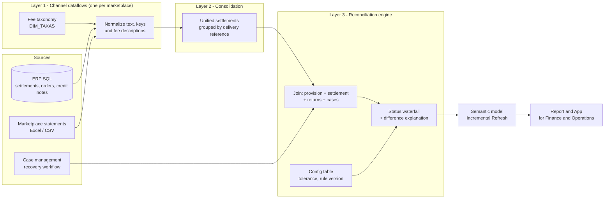

# Marketplace Settlement Reconciliation

🇧🇷 [Leia em português](README.pt-BR.md)

A governed data pipeline that reconciles **what a multichannel retailer expected to receive** from marketplaces against **what was actually settled**, order by order, and tells operations exactly what to do with every difference.

> Built on Microsoft Fabric / Power BI dataflows, Power Query (M), SQL (ERP) and a semantic model with Incremental Refresh.
> All code and data in this repository are **sanitized or synthetic**. No company, partner, customer or financial data is included.

## The problem

Marketplaces settle in batches, with their own fee vocabulary, file formats and reference keys. Finance had provisions in the ERP, settlements scattered across eight channel feeds (Amazon, B2W, Magalu, Mercado Livre, Shopee, TikTok Shop, Via and others), plus returns and a separate case-management process. Nobody could answer quickly: *which orders were settled correctly, which are pending, which were reversed, which are worth chasing?*

## The solution



1. **Channel dataflows** – one per marketplace. Each one extracts from its own source (ERP SQL through an on-premises gateway, or statement files), normalizes order references, and maps free-text fee descriptions to a common taxonomy.
2. **Fee taxonomy (`DIM_TAXAS`)** – description → category (sale, commission, freight, promotion, fixed fee, other adjustments, reversal, refund). Descriptions are normalized (lower-case, digits and punctuation stripped) to build a stable linking key. Fees with no mapping are exposed in a dedicated query, so the taxonomy gets fixed instead of silently leaking value.
3. **Consolidation** – all channels are stacked and grouped by delivery reference and channel, summing each component.
4. **Reconciliation engine** – joins provision, settlement, returns (credit notes) and the status of any recovery case, then applies a **strict-priority status waterfall**. Every order ends up with exactly one status and, when there is a difference, a text explaining *which component* diverged and in which direction.
5. **Governed parameters** – the tolerance (R$) and the rules version live in a config table read through a `fn_GetParam` function, so changing a rule is a one-line, auditable change rather than an edit buried in the logic.
6. **Delivery** – a semantic model with **Incremental Refresh** (see below), a report, and a workspace App for Finance and Operations.

### Incremental Refresh

The reconciliation entity filters on the billing date, keeps **2 years** of history, refreshes only the **last 3 months**, and uses change detection on the same column.


## Status taxonomy

Evaluated top to bottom; the first rule that matches wins.

| Level | Statuses | Meaning |
|---|---|---|
| 0 | Not provisioned | Nothing expected and nothing received |
| 1A | Returned with positive settlement | Physical return **and** money received above provision (conflict worth chasing) |
| 1 | Cancelled, Not shipped, Returned | Physical status closes the order |
| 2 | Received above provision, Received OK, Zero or negative | Financially resolved |
| 3 | Justified, Data ticket (pending / reversal / not reimbursed / other), Damage recovery, Recovery case, Recovered (customer / carrier / marketplace / data) | A handling action is already registered |
| 4 | Settlement pending, Review queue | Waiting, or needs a human |

## Run the reference implementation

The production logic is Power Query M ([`power-query/`](power-query)). To make the rules easy to read, test and review, [`reference_implementation/`](reference_implementation) re-implements the waterfall in Python and runs it on **synthetic** orders.

```bash
python reference_implementation/generate_sample_data.py
python reference_implementation/run_reconciliation.py
pip install pytest && pytest -q
```

## Repository map

| Path | What it is |
|---|---|
| `power-query/` | Sanitized M excerpts: config table, parameter function, grouping, status engine, one channel normalization example |
| `reference_implementation/` | Python version of the status waterfall + synthetic data generator |
| `sample_data/` | Generated synthetic orders and settlements |
| `tests/` | Unit tests for the priority rules and tolerance |
| `docs/` | Evidence from the live environment (sanitized) |

## Design decisions worth noting

- **Rules as data, not as code scattered in queries** – tolerance and rule version are parameters.
- **Strict hierarchy** – no order can be in two statuses; the physical state outranks the financial one, except when they conflict, which gets its own status.
- **Data quality surfaced, not hidden** – unmapped fees have their own output.
- **Layered dataflows** – source-specific logic stays in the channel layer; the engine never knows where a number came from.
- **Migration path** – the engine was rebuilt in a test dataflow on Dataflow Gen2 while production runs on Gen1.

<!-- RESULTS: add measurable outcomes here later (amount recovered, hours saved, % orders auto-classified, refresh time before/after). -->

## About

Built and maintained by [Bárbara Gomes](https://github.com/Barbarags) – Data & BI Coordinator.
