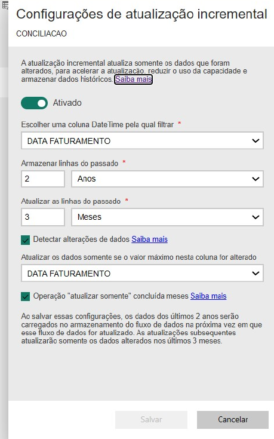

# Conciliação de Repasses de Marketplaces

🇬🇧 [Read in English](README.md)

Pipeline de dados governado que compara **o que um varejista multicanal esperava receber** dos marketplaces com **o que foi de fato repassado**, pedido a pedido, e indica à operação exatamente o que fazer com cada diferença.

> Construído com dataflows do Microsoft Fabric / Power BI, Power Query (M), SQL (ERP) e modelo semântico com Atualização Incremental.
> Todo código e dado deste repositório é **sanitizado ou sintético**. Não há dados de empresa, parceiros, clientes ou valores reais.

## O problema

Cada marketplace repassa em lotes, com vocabulário de taxas, formato de arquivo e chave de referência próprios. O financeiro tinha as provisões no ERP, os repasses espalhados em oito fontes de canal (Amazon, B2W, Magalu, Mercado Livre, Shopee, TikTok Shop, Via e outros), além de devoluções e de um processo separado de tratativas. Ninguém respondia rápido: *quais pedidos foram repassados corretamente, quais estão pendentes, quais foram estornados, quais valem a cobrança?*

## A solução

O fluxo (diagrama no [README em inglês](README.md#the-solution)):

1. **Dataflows por canal** – um por marketplace. Cada um extrai da sua origem (SQL do ERP via gateway local ou arquivos de extrato), normaliza as referências de pedido e mapeia descrições livres de taxa para uma taxonomia comum.
2. **Taxonomia de taxas (`DIM_TAXAS`)** – descrição → categoria (venda, comissão, frete, promoção, taxa fixa, outros ajustes, estorno, reembolso). As descrições são normalizadas (minúsculas, sem dígitos e pontuação) para formar uma chave de vínculo estável. Taxas sem mapeamento aparecem em uma consulta própria, para a taxonomia ser corrigida em vez de perder valor em silêncio.
3. **Consolidação** – todos os canais são empilhados e agrupados por referência de entrega e canal, somando cada componente.
4. **Motor de conciliação** – cruza provisão, repasse, devoluções (notas de crédito) e o status de eventual tratativa de recuperação, e aplica uma **cascata de status com prioridade estrita**. Cada pedido termina com exatamente um status e, havendo diferença, um texto explicando *qual componente* divergiu e em que direção.
5. **Parâmetros governados** – a tolerância (R$) e a versão das regras ficam em uma tabela de configuração lida pela função `fn_GetParam`; mudar uma regra vira uma alteração de uma linha, auditável.
6. **Entrega** – modelo semântico com **Atualização Incremental**, relatório e App no workspace para Financeiro e Operações.

### Atualização Incremental

A entidade de conciliação filtra pela data de faturamento, mantém **2 anos** de histórico, atualiza só os **últimos 3 meses** e usa detecção de alterações na mesma coluna.



## Taxonomia de status

Avaliada de cima para baixo; vale a primeira regra que casar.

| Nível | Status | Significado |
|---|---|---|
| 0 | Não provisionado | Nada esperado e nada recebido |
| 1A | Devolvido com repasse positivo | Devolução física **e** valor recebido acima da provisão (conflito que vale cobrar) |
| 1 | Cancelado, Não embarcado, Devolvido | O estado físico encerra o pedido |
| 2 | Recebido acima da provisão, Recebido ok, Zero ou negativo | Resolvido financeiramente |
| 3 | Justificado, Chamado Dados (pendente / estorno / não indenizado / outros), Dano, Em recuperação, Recuperado (cliente / transportadora / marketplace / dados) | Já existe uma ação registrada |
| 4 | Repasse pendente, Fila para análise | Aguardando, ou precisa de pessoa |

## Executar a implementação de referência

A lógica de produção está em Power Query M ([`power-query/`](power-query)). Para facilitar leitura, teste e revisão das regras, [`reference_implementation/`](reference_implementation) reimplementa a cascata em Python sobre pedidos **sintéticos**.

```bash
python reference_implementation/generate_sample_data.py
python reference_implementation/run_reconciliation.py
pip install pytest && pytest -q
```

## Decisões de projeto

- **Regras como dado**, não código espalhado nas consultas: tolerância e versão são parâmetros.
- **Hierarquia estrita**: nenhum pedido tem dois status; o estado físico vale mais que o financeiro, exceto quando conflitam, o que ganha status próprio.
- **Qualidade de dado exposta**: taxas sem cadastro têm saída própria.
- **Dataflows em camadas**: a lógica específica de cada fonte fica na camada de canal; o motor não sabe de onde veio o número.

<!-- RESULTADOS: incluir depois (valor recuperado, horas economizadas, % de pedidos classificados automaticamente, tempo de refresh antes/depois). -->

## Autoria

Construído e mantido por [Bárbara Gomes](https://github.com/Barbarags) – Coordenadora de Dados e BI.
